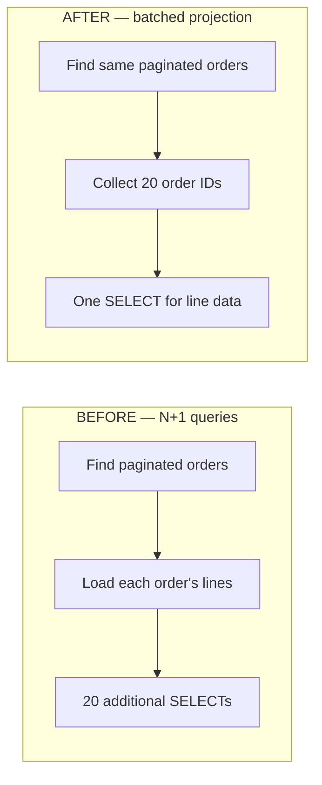
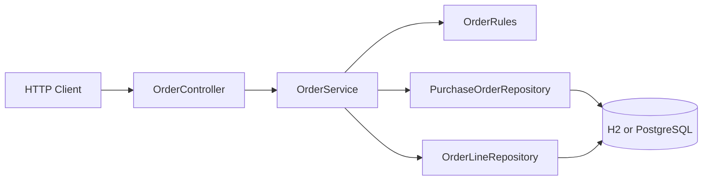

# OrderFlow — Java Backend Modernization Case Study

[](https://github.com/lkorkulenko/orderflow-java-backend-portfolio/actions/workflows/ci.yml)

**Java 21 · Spring Boot · Hibernate/JPA · REST · SQL performance · Automated tests**

**Original demonstration project; not a paid client deliverable.**

OrderFlow is a small B2B order-processing API built to demonstrate how a senior backend engineer diagnoses and fixes an **N+1 database-query defect** without breaking the API response. It also illustrates reliable domain state transitions, money arithmetic, schema migrations, validation, optimistic locking, and integration tests.

> **Scope warning:** This is an engineering portfolio sample, **not production-ready software**. It does not implement authentication, authorization, rate limiting, audit trails, or a deployment security review. The `/api/orders/legacy` endpoint intentionally retains an inefficient implementation for comparison. By default the server binds to `127.0.0.1` only.

## Business scenario

A B2B fulfillment system must list customer purchase orders with their item quantities and monetary totals. The old code retrieves one page of orders, then lazily loads every order's lines individually. On a 20-order page this produces approximately 20 additional SQL queries, increasing response-time sensitivity to DB round-trips. The refactoring retains the same JSON contract, but fetches the required scalar line data in **one additional batched query** for the selected page.

### Before vs. after

| | Legacy `/api/orders/legacy` | Modern `/api/orders` |
| --- | --- | --- |
| Orders | Paginated Spring Data `Page` | Same paginated `Page` |
| Order lines | One lazy SELECT per order | One `IN (:orderIds)` scalar projection |
| Prepared SQL statements in 20-order CI fixture | **22 measured** | **3 measured** |
| API response structure | `PageResult<OrderSummary>` | Identical |
| Guard against regression | None | Integration test asserts bounded count and output equivalence |

**Verified in GitHub Actions on October 30, 2026:** The H2 integration test counted 22 prepared SQL statements on the legacy route and 3 on the optimized route (86.4% fewer statements) while asserting identical JSON responses. This is not a measured 86.4% reduction in latency. [View the passing CI run](https://github.com/lkorkulenko/orderflow-java-backend-portfolio/actions/runs/41037257946).

### How the refactoring changes database access



The legacy and optimized endpoints return the **same JSON** for the measured test page. The observed improvement concerns the **number of SQL statements**, not a measured response-time improvement.

## Stack

Java 21, Spring Boot 3.5.16, Spring MVC, Spring Data JPA / Hibernate, Bean Validation, Flyway, PostgreSQL (optional), H2 (zero-setup local default), JUnit 5, MockMvc, Maven, GitHub Actions.

Spring Boot 3.5 was selected deliberately for a mature, widely deployable foundation. Java 21 is an LTS runtime.

## Run on Windows

Requirements: JDK 21 and Apache Maven 3.6.3 or later. From the repository root:

```powershell
mvn clean verify
mvn spring-boot:run
```

Alternatively run `./scripts/quickstart.ps1`. The application starts at `http://127.0.0.1:8080`. H2 is in-memory; data resets with the application.

No Maven installed? You can still validate the pure Java domain rules with:

```powershell
./scripts/domain-smoke.ps1
```

### Optional real PostgreSQL

```powershell
docker compose up -d
$env:ORDERFLOW_DB_PASSWORD = 'local-only-change-me'
mvn spring-boot:run '-Dspring-boot.run.profiles=postgres'
```

The example database password is **local demo only**; use secrets and stronger credentials in a real deployment. The Postgres profile still binds the API to `127.0.0.1`.

## Try the API

Create one order:

```powershell
$body = @{
  clientReference = 'CLIENT-2026-001'
  lines = @(
    @{ sku = 'NOTEBOOK-01'; quantity = 2; unitPrice = 14.90 },
    @{ sku = 'PEN-02'; quantity = 3; unitPrice = 1.50 }
  )
} | ConvertTo-Json -Depth 5

$order = Invoke-RestMethod -Uri 'http://127.0.0.1:8080/api/orders' -Method Post -ContentType 'application/json' -Body $body
$order
Invoke-RestMethod 'http://127.0.0.1:8080/api/orders?page=0&size=20'
Invoke-RestMethod 'http://127.0.0.1:8080/api/orders/legacy?page=0&size=20'
Invoke-RestMethod -Uri "http://127.0.0.1:8080/api/orders/$($order.id)/status" -Method Patch -ContentType 'application/json' -Body '{"status":"PROCESSING"}'
```

## API contract

| Method | Path | Result |
| --- | --- | --- |
| `POST` | `/api/orders` | Creates order (`201`), rejects duplicate reference (`409`) |
| `GET` | `/api/orders` | Optimized paginated summaries |
| `GET` | `/api/orders/legacy` | Intentionally inefficient baseline, same response |
| `GET` | `/api/orders/{id}` | Details with line totals |
| `PATCH` | `/api/orders/{id}/status` | Enforced state transition |
| `GET` | `/actuator/health` | Health indicator |

Valid lifecycle: `NEW` -> `PROCESSING` -> `SHIPPED`; `NEW` or `PROCESSING` can go to `CANCELLED`. Invalid transitions respond with `409 Conflict`. Missing orders return `404`, bad payloads `400`. Duplicate `clientReference` is prevented by a database unique constraint. Financial values use `BigDecimal` and database `DECIMAL`, not `double`. A Hibernate `@Version` protects against silent concurrent status changes. API error responses use Spring `ProblemDetail` (RFC 9457 style).

## Verification

- `OrderRulesTest`: unit tests for state transitions and decimal math.
- `OrderApiIntegrationTest`: real Spring HTTP integration tests on H2 with Flyway.
- N+1 regression: compares both API responses and their Hibernate prepared-statement counts on a page of 20 orders.
- CI: `.github/workflows/ci.yml` runs `mvn verify` on push and pull requests.

**Latest CI verification (October 31, 2026):** Java 21 / Maven `verify` completed successfully with **8 tests, 0 failures, 0 errors, 0 skipped**. The tests cover invalid order lines and confirm unchanged legacy/optimized responses and 22 vs 3 prepared SQL statements on the 20-order H2 fixture. [Successful verification run](https://github.com/lkorkulenko/orderflow-java-backend-portfolio/actions/runs/41202708566). PostgreSQL integration and production security have not been verified. See `docs/VALIDATION.md`.

## Architecture



The optimized read model pages order headers first, then loads only fields needed for a summary (`orderId`, `quantity`, `unitPrice`) in one query for the page's order IDs. It deliberately avoids `JOIN FETCH` with a paginated collection, which can cause incorrect paging or in-memory pagination depending on ORM behavior.

## Portfolio packaging

See [`docs/CASE_STUDY.md`](docs/CASE_STUDY.md) and [`docs/UPWORK_PORTFOLIO.md`](docs/UPWORK_PORTFOLIO.md). This repository is an **independent educational demonstration**, not commercial or employer code. The repository is **public**, with source, tests, and CI evidence available for independent review. It is **not production-ready**, and SQL-statement counts must not be presented as end-to-end latency measurements.

**License:** MIT.
